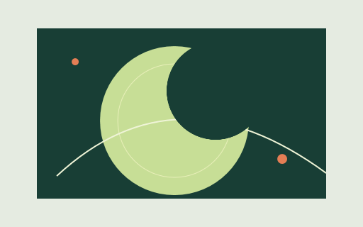

<p align="center"></p>
<h1 align="center">SVGImage</h1>
<p align="center"><strong>SVG, naturally at home in WPF.</strong></p>
<p align="center">A native WPF SVG control and Drawing-based renderer for icons, illustrations and supported animation.</p>
<p align="center"><a href="https://dotnetprojects.github.io/SVGImage/">Homepage</a> · <a href="Docs/GettingStarted.md">Get started</a> · <a href="Docs/Support.md">SVG support</a> · <a href="CHANGELOG.md">Changelog</a> · <a href="https://www.nuget.org/packages/DotNetProjects.SVGImage">NuGet</a></p>

<p align="center">  </p>
<p align="center"><sub>Original examples, rendered with SVGImage. <a href="Docs/images/demos">Explore the SVG sources.</a></sub></p>

## What can it render?

| Area | Current source support |
| --- | --- |
| Geometry | Basic shapes, paths/curves/arcs, transforms and groups |
| Composition | Luminance/alpha masks, clip paths, patterns, symbol/use and nested viewports |
| Paint | Linear/radial gradients, spreading, CSS colors, per-use opacity and color overrides |
| Text | Styled spans, text anchoring and glyphs along a textPath |
| Filters | Turbulence, displacement, flood, offset, merge, composite, color matrices, component transfer, blend, blur, morphology and tile |
| CSS | Author cascade, supported selectors, specificity, variables and transform/opacity keyframes |
| SMIL | Native clocks, transforms, motion paths, supported properties, timing and explicit events |
| WPF | Drawing access, intrinsic button sizing, grayscale and deterministic seeking |

See the [support reference](Docs/Support.md) for scope and limits. The current source includes **unreleased changes**; published package availability is recorded in the changelog. The full SVG/resvg specification remains a work in progress.

## Get started

Install a published package:

```powershell
dotnet add package DotNetProjects.SVGImage
```

Add `xmlns:svg="https://github.com/dotnetprojects/SVGImage"` to your WPF window, then use:

```xml
<svg:SVGImage UriSource="Assets/illustration.svg"
              Width="320" Height="240"
              UseAnimations="True"
              SizeType="ViewBoxToSizeNoStretch" />
```

Add the SVG as Content and copy it to your output directory. [Installation and first steps →](Docs/GettingStarted.md)

## Frameworks

Windows / WPF. Targets: **.NET Framework 4.0, 4.5, 4.6, 4.7, 4.8**, **.NET Core 3.1**, and **.NET 6, 7, 8 for Windows**.

```powershell
dotnet build Source/SVGImage/DotNetProjects.SVGImage.csproj -p:GeneratePackageOnBuild=false
```

Use `Source/SVGImage.sln` with Visual Studio 2022. For unreleased features, reference the current library project or a locally built DLL.

## Documentation and change history

- [Homepage and native-rendered gallery](https://dotnetprojects.github.io/SVGImage/)
- [Support reference](Docs/Support.md) and [ongoing changelog](CHANGELOG.md)
- [Masks](Docs/Masks.md), [CSS](Docs/CSS.md), [animation](Docs/Animations.md), [rendering and filters](Docs/Rendering.md), [grayscale](Docs/Grayscale.md)
- [Samples](Samples) and [regression checks](Tests/RegressionTests/README.md)

Selected verification includes 223 external SVG checks, 14 animation examples and a mask fixture compared against Chromium. Downloaded samples/reference suites remain outside the repository.

## Contributing and license

[Contributions and SVG reproductions](https://github.com/dotnetprojects/SVGImage/issues) are welcome. See [CONTRIBUTING.md](CONTRIBUTING.md); user-visible changes belong in the [changelog](CHANGELOG.md), which also feeds the website.

[MIT licensed](LICENSE), with permission from the original author. Originally forked from the [SVGImage Control CodeProject article](https://www.codeproject.com/Articles/92434/SVGImage-Control).


